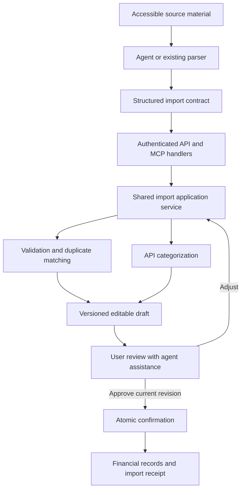
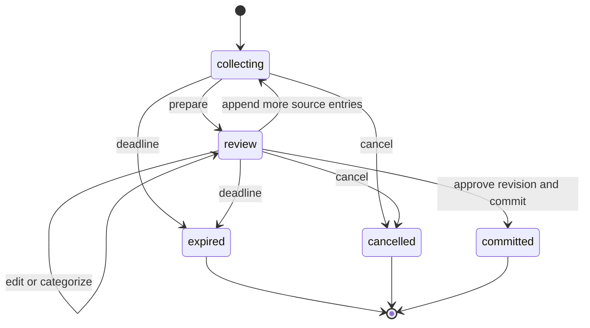

# Agent assisted imports through the Family Finance API and MCP

Date: 2026-10-12
Status: Draft for product and technical review

## Purpose

A user can give an agent financial information in whatever accessible form they
have and ask it to import the entries into Family Finance. The receiving tenant
is the household associated with the user's authenticated login. A downloadable
statement, bank integration, and institution-specific parser are optional.

Family Finance owns validation, categorization, matching, and persistence. The
agent extracts source information, explains the preview, and translates the
user's corrections into structured edits. Review is a repeatable conversation,
followed by confirmation of one exact revision.

## Agreed product requirements

- Accept extracted transaction lists, including an open browser statement that
  cannot be downloaded as a PDF.
- Use a versioned, source-independent API contract exposed through MCP tools.
- Derive tenant and acting user from authenticated identity.
- Run automatic categorization in the API using the shared categorization engine.
- Let the user adjust transactions with the agent before confirmation, including
  categories, descriptions, dates, amounts, instruments, responsibility,
  installment decisions, inclusion, and duplicate handling.
- Preserve explicit user edits when automatic categorization runs again.
- Keep original source descriptions separate from editable purchase descriptions.
- Make future merchant learning a separate explicit choice.
- Commit only the reviewed revision, with retry and duplicate protection.

Details labeled **proposed** below are specification recommendations rather than
previously approved product decisions. Section "Decisions before implementation"
collects the consequential choices that still need resolution.

## Scope of the first release

The first release supports BRL expense and income entries on existing accounts
and cards, supported card refunds, and reviewed installment purchases. One draft
can contain several sources and target instruments, with source-level defaults
and explicit row overrides. A single manually described transaction uses the
same workflow as a statement batch.

Inputs include agent-extracted PDF, CSV, OFX, spreadsheet, image, browser, and
pasted-text content. Supporting structured entries extracted from a spreadsheet
does not require building a spreadsheet parser in Family Finance. Existing bank
parsers remain an optional, deterministic extraction path.

Source access belongs to the agent's host. The MCP connection does not grant
access to an open browser tab, a bank session, or every file in a conversation.
If the host cannot access the source, the agent requests accessible content and
does not report an extraction as complete.

Proposed first-release boundaries:

- Pending or unknown posting status can appear in the draft but cannot be booked
  until resolved as posted; excluding them allows other entries to proceed.
- Card-bill payments and transfers are recognized and shown but excluded from
  generic expense/income import. Their existing dedicated accounting operations
  are outside this MCP release.
- Replacing or editing already committed transactions is outside this workflow.
  Existing installment-group matching is allowed; replacing a standalone expense
  with an installment group requires a separate, explicit replacement design.
- No automatic creation of accounts, cards, categories, or household memberships.
- No foreign-currency conversion, unattended confirmation, statement-balance
  reconciliation, or automatic deletion based on missing statement entries.
- No public plugin-directory publication is needed for the private pilot.

**Proposed storage default:** retain normalized import evidence and committed
history, without a Family Finance archive of original files. Original-file
archiving is a separate product decision; it is not required by this API.

## User experience

1. The user connects Family Finance and signs in through account linking.
2. The user supplies accessible material and asks for an import.
3. The agent retrieves context, extracts rows, and resolves an ambiguous account
   or card with the user. It identifies incomplete source coverage.
4. The API prepares a draft, runs validation and matching, and categorizes rows.
5. The agent presents totals, source coverage, selected entries, exclusions,
   duplicate candidates, installment decisions, and unresolved questions.
6. The user requests individual or bulk adjustments. The API applies them and
   returns a new revision with a precise change summary. Repeat as needed.
7. The user confirms the current revision through the chosen confirmation
   surface. The API revalidates and atomically persists the approved draft.
8. The agent reports the receipt, including created records and excluded rows.

Example Portuguese interaction, with illustrative counts:

> User: Importe os lançamentos que estão visíveis nesta fatura do Nubank.
>
> Agent: Preparei 18 lançamentos. Encontrei 3 possíveis duplicatas e 2 compras
> pendentes, que estão fora da seleção. A lista é parcial. Os outros 13 lançamentos
> estão selecionados; 4 precisam de categoria.
>
> User: Coloque Uber em Transporte. A Amazon foi material para a casa. Ignore a
> compra da farmácia e lembre a categoria desse supermercado para a próxima vez.
>
> Agent: Atualizei 2 lançamentos Uber e 1 Amazon, excluí a farmácia e preparei
> 1 preferência para o supermercado. Ela será salva somente ao confirmar a
> importação. Agora são 12 lançamentos selecionados. Veja os valores e as
> decisões na revisão atualizada.

"All Uber entries" resolves to a visible set of stable row IDs in the current
revision. The agent reports which rows changed. If more than one Amazon entry
exists and the intended purchase is unclear, it asks before applying the edit.

## Responsibilities and architecture



The agent must not calculate authoritative totals, invent provider transaction
identifiers, choose arbitrary tenant IDs, or make a suggestion authoritative by
labeling it "user confirmed". All source text is untrusted data, including any
instructions embedded in a statement or merchant description.

Proposed implementation boundaries:

| Component | Responsibility |
| --- | --- |
| `packages/domain` | Pure financial types and validation |
| `packages/importers` | Existing parsers, source normalization, identity primitives |
| `packages/categorization` | Pure categorization rules and provider interfaces |
| New `packages/import-service` | Authenticated-context orchestration, drafts, edits, validation, and confirmation |
| `packages/db` | Repositories, draft storage, tenant isolation, atomic persistence |
| `apps/web` | API routes, existing import UI, authenticated review and approval fallback |
| MCP transport adapter | OAuth resource handling, tool schemas, result formatting |

Start by colocating the MCP adapter with the API if the selected deployment
supports the required transport. A separate `apps/mcp` deployment is optional,
not a prerequisite. Both adapters call the same application service; MCP must
not emulate browser cookies or call private Next.js server-action wire formats.

Adding the application-service package requires updating the package-boundary
ADR: it introduces an explicit orchestration layer above the existing pure
packages and repositories. No package may import `apps/*`; pure categorization
and importer packages must remain free of DB clients and provider implementations.

## Identity and authorization

Every API operation uses an authenticated context assembled by trusted server
code: user ID, active household membership, client identity, and scopes. Request
bodies cannot set `household_id`, `created_by_user_id`, membership, or scopes.

The integration preserves the one-household-per-login product model. No active
membership means access denied. Unexpected multiple active memberships fail
closed instead of selecting the first result. A hostname, card name, email
argument, or conversation instruction cannot select a tenant.

Proposed scopes are `finance:context:read`, `imports:read`, `imports:prepare`, and
`imports:commit`. Preparing includes draft edits and temporary storage; it does
not authorize financial writes. Commit scope is necessary but does not replace
review approval.

Drafts are private to their creating user within the household in the first
release. Another household member cannot inspect or confirm that user's draft.
Committed financial records follow existing household visibility; import-history
endpoints must preserve existing authorized visibility and never widen it.

Every read, edit, renewal, approval, and commit checks identity, active membership,
draft ownership, and relevant scope. Every referenced account, card, category,
subcategory, responsible person, match candidate, and installment group must
belong to the same household. Cross-tenant object lookups return a non-disclosing
not-found response. Database RLS and household-scoped foreign keys enforce the
same boundary below the service layer.

ChatGPT account linking uses OAuth 2.1 with PKCE, protected-resource discovery,
and token validation for issuer, audience, expiry, and scopes. Use an established
authorization server. The deployed Supabase Auth capabilities and the secure
mapping to the existing database user identity must be verified before selecting
the provider. A generic external token is not automatically a Supabase session.
See the [OpenAI authentication guide](https://developers.openai.com/plugins/build/auth).

Tokens and financial data must not appear in request logs. Revocation and removed
membership must prevent subsequent operations. Do not use a shared master token
or service-role access for ordinary financial reads and writes.

## Structured intake contract

The public contract is versioned as `schema_version: "1"`. Unknown versions and
unknown write fields are rejected. One draft contains one or more sources and
entries. Sources describe where information came from; target instruments describe
where it will be booked. These are independent concepts.

The following is an illustrative create request. IDs are examples; production
instrument IDs must come from the authenticated context endpoint.

```json
{
  "schema_version": "1",
  "sources": [
    {
      "client_source_id": "source-1",
      "type": "browser_statement",
      "institution": "Nubank",
      "label": "October open statement",
      "coverage": "partial",
      "captured_at": "2026-10-12T13:00:00Z",
      "default_target": { "type": "card", "id": "card-from-context" }
    }
  ],
  "entries": [
    {
      "client_row_id": "row-1",
      "client_source_id": "source-1",
      "observed": {
        "description_original": "SUPERMERCADO EXEMPLO",
        "evidence_text": "10 OUT · SUPERMERCADO EXEMPLO · R$ 85,90",
        "locator": "Visible list, item 1"
      },
      "proposed": {
        "occurred_on": "2026-10-10",
        "amount_cents": 8590,
        "currency": "BRL",
        "kind": "expense",
        "posting_status": "posted"
      },
      "uncertainties": []
    }
  ]
}
```

| Field | Contract and validation |
| --- | --- |
| Source type | `browser_statement`, `pdf`, `csv`, `ofx`, `spreadsheet`, `image`, `pasted_text`, or `manual` |
| Coverage | `complete`, `partial`, or `unknown`; no completeness inference from row count |
| Source metadata | Optional institution, period, reference month, filename label, captured time, and comparable source total |
| Client source and row IDs | Stable ingestion/retry references unique inside the draft; never evidence of a bank-native identity |
| Server row ID | Allocated once; stable across sorting, pagination, exclusions, and edits |
| Observed fields | Immutable extraction evidence, with parser/agent origin recorded by the service; not proof that an extraction was correct |
| Proposed fields | Editable financial interpretation; source description and purchase description remain separate |
| Amount | Positive safe integer cents; direction follows validated kind; currency must be BRL |
| Dates | Real ISO dates; missing year or ambiguous date is unresolved unless source context supports it |
| Kind | `expense`, `income`, `refund`, `card_payment`, `transfer`, or `unknown` at intake; map only supported semantics to existing domain records |
| Posting status | `posted`, `pending`, or `unknown`; no silent conversion from pending to posted |
| Target | Account/card reference, optional until review; same-tenant verification mandatory before inclusion |
| Responsibility | Household default or an active same-household member; does not change acting user |
| Installment observation | Observed installment number/count, optional purchase date and total, with explicit inference flags |
| Provider reference | Optional institution/account-scoped native ID plus origin; model claims are untrusted and cannot alone establish an exact match |
| Source category | Original label only; must resolve through the tenant's catalog, not become a taxonomy ID automatically |
| Uncertainties | Field-specific code, explanation, and source locator; no fabricated values to satisfy validation |

Malformed JSON, invalid field types, unknown versions, and forbidden identity
fields reject the request. Well-formed entries with missing or invalid financial
values become reviewable rows with blocking issues. Null represents unknown;
zero and a guessed current date must not be used as substitutes.

An agent may suggest a category, but the API records it as an agent suggestion.
It does not outrank confirmed memory or an explicit review choice. No arbitrary
SQL, executable expressions, remote URLs to crawl, or opaque provider payloads
are accepted in the structured import contract.

## Draft lifecycle and persistence

Proposed states are `collecting`, `review`, `committed`, `cancelled`, and `expired`.
Readiness is a derived `can_confirm` result, not a separate mutable status.

`collecting` allows chunked extraction without presenting an unfinished list as
ready. Preparing closes ingestion and enters `review`. Each accepted change to
source coverage, entries, suggestions, selections, learning choices, or matches
increments the draft revision and invalidates existing approval. Appending rows
to a review draft returns it to `collecting`; it must be prepared again.



Keep the existing 30-minute preview validity; edits and AI retries do not silently
extend it. Proposed timing: collection expires after 30 minutes, and the first
successful prepare starts a 30-minute review window. Returning to collection
after review does not reset that review deadline. Renewal creates a new draft
generation and reruns current validation, matching, and categorization while
preserving explicit decisions that remain valid.

**Proposed recovery retention:** retain normalized data for an expired draft for
24 hours from expiration, accessible only to its owner for renewal. Renewal never
makes the old generation confirmable; at most one generation in a lineage may
commit. Cancellation removes the uncommitted payload. Cleanup removes expired
payloads after the recovery window. This retention is new behavior and requires
approval separately from the unchanged 30-minute confirmation window.

Proposed persistence concepts, with exact SQL deferred to the implementation plan:

- Draft metadata: household, creator, lineage, revision, state, deadlines, and
  idempotency records.
- Draft sources and rows: immutable extraction evidence, editable fields,
  selections, categorization provenance, matching decisions, and validation issues.
- Draft events: bounded before/after edits and caller identity for review history.
- Approval: trusted user action bound to owner, draft generation, revision,
  canonical content hash, and expiry.
- Existing import batches, rows, claims, transactions, and installment groups:
  durable receipt and evidence after commit.

Keep raw file bytes transient. Do not retain full browser pages, URL query strings,
cookies, access tokens, or full card numbers in evidence. Save the minimum source
text required to review and trace each imported row. ChatGPT or another host has
its own file storage policy; Family Finance cleanup does not delete host copies.

## API operations and MCP tools

HTTP paths below are proposed. MCP and HTTP handlers invoke the same service and
use the same schemas, authorization, error codes, and idempotency semantics.

| MCP tool | HTTP operation | Result |
| --- | --- | --- |
| `get_import_context` | `GET /api/v1/import-context` | Resolved household, available instruments, members, catalog, capabilities, and limits |
| `create_import` | `POST /api/v1/imports` | Collecting draft with initial sources and entries |
| `append_import_entries` | `POST /api/v1/imports/{id}/entries` | Atomic append of sources or entries, with stable ID mapping |
| `prepare_import` | `POST /api/v1/imports/{id}/prepare` | Review revision, deterministic categories, matching, issues, and totals |
| `get_import` | `GET /api/v1/imports/{id}` | Current summary, deadlines, readiness, or committed receipt |
| `get_import_rows` | `GET /api/v1/imports/{id}/rows` | Filtered, revision-bound cursor page |
| `update_import` | `PATCH /api/v1/imports/{id}` | Atomic edits and updated review summary |
| `categorize_import` | `POST /api/v1/imports/{id}/categorize` | Bounded enrichment of unresolved eligible rows |
| `request_import_confirmation` | `POST /api/v1/imports/{id}/confirmation` | Review challenge for the exact current revision |
| `confirm_import` | `POST /api/v1/imports/{id}/confirm` | Atomic commit using an existing valid user approval |
| `renew_import` | `POST /api/v1/imports/{id}/renew` | New generation with current validation and preserved valid choices |
| `cancel_import` | `POST /api/v1/imports/{id}/cancel` | Cancelled draft and removed uncommitted payload |

Mutations require an `Idempotency-Key` header; MCP carries the equivalent
`idempotency_key` argument. After creation, mutations also require
`expected_revision`. Key scope includes authenticated user, tenant, operation,
and draft where applicable. Same key and canonical request returns the original
operation result; same key with changed content returns a conflict. Returning a
prior revision from a retry must instruct the client to fetch current state.

Reusing a `client_row_id` with different observed content is a conflict. Correcting
an extraction uses an explicit edit with a reason; it does not erase the original
observation or masquerade as a retransmission.

Proposed starting bounds: 10,000 entries per draft, 200 entries per append, 100
rows per response page, 500 row targets per edit, and 2 MiB per JSON request.
Validate bounded text fields and nesting. Publish limits in context so clients
can chunk requests. Never truncate or silently discard an oversized batch.

Summaries contain revision, expiry, source coverage, counts by disposition,
selected outflows and inflows, totals per instrument, unresolved issue counts,
pending learning commands, and `can_confirm`. Counts must reconcile to the full
draft, including unresolved and excluded rows. Receipt counts distinguish source
rows from created transactions and installment groups.

Read tools are marked read-only. Draft operations and categorization that update
stored results are write tools even before financial commit. Confirmation and
other tool annotations must reflect actual effects; annotations do not replace
server authorization. See the [OpenAI MCP server guide](https://developers.openai.com/plugins/build/mcp-server).

## Editing and concurrent review

Edits target server row IDs at an expected revision. Free-text commands and
unbounded semantic filters are interpreted by the agent, not executed by the API.
The agent can fetch/filter rows, resolve a selection, and submit the explicit IDs.

Supported typed actions are `set_fields`, `set_category`, `clear_category`,
`reset_category_to_auto`, `set_included`, `resolve_match`, and `set_learning`.
`set_fields` has an allowlist for date, amount, kind, posting status, target,
responsibility, purchase description, and installment interpretation. It cannot
modify extraction evidence, tenant, author, server provenance, or approval.

```json
{
  "expected_revision": 3,
  "changes": [
    {
      "action": "set_category",
      "row_ids": ["draft-row-7", "draft-row-12"],
      "category_id": "transport-category-from-context",
      "subcategory_id": null
    },
    {
      "action": "set_included",
      "row_ids": ["draft-row-9"],
      "included": false,
      "reason": "User asked to skip this purchase"
    }
  ]
}
```

A patch is all-or-nothing. Invalid references or an invalid action reject the
patch with row-specific details. Valid edits can leave a draft with unresolved
financial issues, but those issues block affected included rows from commit.
Conflicting actions for the same field in one patch reject the patch.

An omitted field leaves it unchanged; an explicit null clears only a nullable
field. Changing a category clears an incompatible subcategory. Explicitly leaving
a row uncategorized is a user choice and survives automatic enrichment until
`reset_category_to_auto` is requested.

Money, date, instrument, posting status, kind, and installment edits rerun affected
validation and matching. Changing merchant interpretation invalidates affected
automatic suggestions and pending merchant-learning commands; the immutable
source descriptor remains intact. Responsibility does not alter who authored
the import. Each result includes changed row IDs, before/after values, changed
totals, remaining issues, and the new revision.

Stale revisions return `REVISION_CONFLICT` with current revision metadata. No
last-write-wins behavior. Pagination cursors bind to a revision; after a revision
change, callers restart pagination before issuing a bulk edit.

## Automatic categorization and learning

The API owns the cascade, using the existing shared engine:

1. Explicit user choice, including explicit uncategorized.
2. Confirmed household merchant memory, including suppression.
3. Confirmed household source-category mapping.
4. Deterministic rules and aliases.
5. Bounded AI suggestions for eligible unresolved expense rows.
6. Uncategorized.

Equally specific conflicting confirmed memories abstain and request review rather
than silently falling through. Inferred memory never acts as deterministic truth.
Income and refunds use compatible deterministic rules or remain uncategorized;
do not expand expense-only AI categorization into new financial semantics here.

Source mappings use a stable institution/format namespace when known. A generic
source type such as `browser_statement` is too broad to learn a category mapping
across unrelated banks. Unknown namespaces may produce suggestions but cannot
create a reusable source mapping until disambiguated.

Return suggestion source, explanation, confidence where available, whether it
requires review, and whether the selection was explicitly edited. Extraction
confidence, duplicate confidence, and categorization confidence are separate.
Agent-supplied provenance is recorded as agent input, never trusted as API output.

AI work is bounded by existing quota/budget policy. Timeout or provider failure
leaves the draft usable. Late AI results apply only when the relevant row inputs
and explicit-choice state still match the captured revision; stale results are
discarded. Applying results increments the revision and invalidates approval.
No background categorization may change a frozen approval snapshot silently.

Learning is off by default. "Change this category", "apply to these rows", and
"remember for future imports" are distinct operations. Preview edits stage
learning commands; only successful confirmation writes them as confirmed memory.
Learning uses original merchant evidence, is scoped to household and row kind,
and never comes from a guessed purchase label. Excluded/error rows do not teach;
learning from a skipped existing transaction is deferred to a dedicated workflow.
Conflicting learning commands block confirmation until resolved.

## Duplicate detection and open statements

Separate request idempotency from economic duplicate detection:

| Signal | Behavior |
| --- | --- |
| Same request key and payload | Replay the original result without new records |
| Verified native identity in the same instrument scope | Exact existing-item candidate; no second financial artifact |
| Agent-reported native identifier | Evidence requiring corroboration, not an automatic exact-identity guarantee |
| Same normalized fields without a reliable native ID | Probable duplicate; show candidates and require a decision |
| Same file or source label | Reuse history as context; never assume every row is already imported |
| Equal amount/date/merchant on multiple rows | Preserve row multiplicity and allow review of legitimate repeated purchases |
| Later partial/open-statement import | Add reviewed new entries; missing old entries do not delete or edit records |

Preserve account/card scoping and existing composite provider-ID rules. Source
identity remains distinct from edited display fields. Changing categories or
purchase descriptions must not make an old import look new. Corrected amount or
date reruns semantic matching without erasing the original observation.

Probable matches default to unresolved/excluded and cannot be silently skipped
without appearing in the preview. The user chooses keep-existing/skip or import
as-separate with a reason. Exact claims cannot be bypassed through this first
release. Responses expose candidate facts from the same household only.

The commit rechecks claims and current candidates under transaction locking. A
new collision after review returns `REVIEW_CHANGED`, creates no financial writes,
and requires a fresh revision and approval. Simultaneous overlapping drafts must
not both pass an advisory-only check. Prefer a household/instrument-scoped lock
in the pilot if existing claim keys cannot serialize a probable-match race.

Pending entries are excluded in the proposed first release, so a later posted
entry can enter the normal review path without duplicating a booked pending
transaction. Supporting booked pending entries later needs an explicit
pending-to-posted reconciliation design.

## Installments and accounting semantics

An observed "3/10" describes installment position, not purchase identity. Show
existing group candidates using amount, count, instrument, and source context.
Do not reconstruct a new full purchase for every occurrence of its installment.

Keep observed installment amount/count separate from inferred purchase date and
total. Estimated totals require explicit acceptance; equal installments can have
rounding differences. Generated schedules must use the existing domain functions,
sum exactly to the approved total, and avoid duplicating a matched group.

A card refund must map to the application's supported card-credit semantics,
preserving instrument and polarity. Unknown financial semantics block inclusion.
Card payments and account transfers remain explicit exclusions with notices;
they must never become fresh expenses because their source amount is negative.

If a source provides a comparable transaction subtotal, compare it against the
extracted relevant rows and disclose discrepancies. A closing balance or payable
invoice total is not automatically comparable because it can contain prior
balances, fees, and payments. Partial coverage is always visible, including on
the final receipt.

## Confirmation and atomic persistence

Confirmation binds to the draft generation, exact revision, selected row set,
edits, target instruments, match resolutions, learning commands, and canonical
payload hash. The API recomputes totals and never accepts client summary counts
as authoritative. Any material change invalidates prior approval.

**Proposed enforceable approval mechanism:** request a review challenge, show the
snapshot in an authenticated Family Finance review surface, and record the user's
explicit confirmation there. The server issues a single-use approval record
bounded by the preview expiry. An embedded ChatGPT surface may provide the same
experience only if it securely authenticates the user and preserves the approval
boundary; otherwise use an authenticated review link.

The MCP token can request a challenge and commit an approved snapshot but cannot
mint approval by submitting `confirmed: true` or a claimed conversation quote.
The review endpoint uses the browser's authenticated session, appropriate origin
and CSRF controls, and an explicit user gesture; fetching the link is not approval.
Do not expose an equivalent approval-minting MCP tool. A documented host approval
mechanism may replace this only after its trust and revision binding are proven.
This choice is a product gate because it may require a final click outside chat.

In one database transaction, recheck membership, draft state, expiry, ownership,
revision/hash, approval, catalog references, supported semantics, and duplicate
claims; write financial artifacts, source-row audit, selected learning, receipt,
and committed state; consume approval. A failed transaction changes none of
those durable financial artifacts. Cache/UI revalidation happens after commit.

Allocate the commit identity on the server so changing a client retry key cannot
commit the same draft twice. Lock draft lineage as well as duplicate scope so
renewed and original generations cannot both commit. Idempotent successful
replays return the existing receipt even after approval expiry, following fresh
authorization; they do not require or consume another approval.

A receipt includes batch ID, committed revision/time, source coverage, actor,
created transaction/group IDs, per-instrument totals, dispositions, learning
outcome, and an authorized Family Finance link. A network timeout is an unknown
outcome; the agent fetches status or retries the same key before claiming failure
or success. Committed drafts are immutable through these endpoints.

## Errors and recovery

Errors return a stable code, readable explanation, affected row IDs/fields when
appropriate, current revision where safe, and a recovery action. Never expose
SQL errors, tokens, foreign-tenant IDs, or complete source documents.

| Code | Recovery |
| --- | --- |
| `AUTH_REQUIRED` | Reconnect; preserve client extraction work |
| `MEMBERSHIP_REQUIRED` or `SCOPE_REQUIRED` | Stop the operation; do not choose another tenant |
| `NOT_FOUND` | Do not reveal whether an inaccessible draft or object exists |
| `UNSUPPORTED_SCHEMA` or `INVALID_REQUEST` | Correct the request contract |
| `LIMIT_EXCEEDED` | Chunk within published limits; do not truncate |
| `REVISION_CONFLICT` | Fetch current preview and reapply still-intended edits |
| `IDEMPOTENCY_CONFLICT` | Reconcile the earlier operation before changing keys |
| `DRAFT_EXPIRED` | Renew if recovery data exists, otherwise resubmit source data |
| `VALIDATION_REQUIRED` | Resolve or explicitly exclude affected rows |
| `APPROVAL_REQUIRED` | Complete the current revision's approval flow |
| `REVIEW_CHANGED` | Present the refreshed preview and obtain new approval |
| `RATE_LIMITED` | Follow retry metadata; do not multiply AI jobs |
| `TEMPORARY_FAILURE` | Query status before retrying a mutation |

Categorization failures are warnings unless the user chose to require a category;
valid explicitly uncategorized entries can be committed. Zero selected financial
entries cannot produce a financial batch; retain the review outcome until expiry
or let the user cancel.

## Implementation sequence

1. **Confirm foundations.** Reconcile the implementation checkout with the current
   tenant-isolation release; select OAuth/user-token integration; prove the chosen
   confirmation surface; settle retention. Produce the implementation plan before
   changing behavior.
2. **Extract shared import services.** Preserve existing website/parser behavior,
   signed-preview semantics, categorization ordering, claims, and atomic writes.
   Update the package-boundary ADR.
3. **Add versioned drafts and structured API.** Add schema validation, chunked
   ingestion, stable row IDs, revisions, RLS, TTL/recovery, and idempotent edits.
   Keep writes behind a deployment feature gate until confirmation is ready.
4. **Complete the review loop.** Integrate API categorization, row/bulk adjustments,
   learning, duplicate decisions, approval, atomic confirmation, and receipts.
5. **Expose MCP and run the private pilot.** Publish focused tools with OAuth,
   test source-access limitations, and verify the full workflow in ChatGPT.
6. **Improve source and review conveniences.** Add direct file-tool ingestion and
   richer embedded review UI where useful; do not make these prerequisites for
   importing an agent-extracted browser list.

Use forward migrations for draft storage, provenance, and any import-source enum
extension needed for generic agent intake. Do not pretend a browser list is a
Nubank CSV to fit an old enum. Keep the new API schema version separate from the
parser, identity, normalization, and categorization-rule versions. Existing
confirmed batches retain their identities. Do not rewrite historical migrations.

The local import implementation on `codex/merchant-categorization-evidence` is a
reuse reference, not the production baseline. The implementation must use the
current tenant authorization and member-authenticated RPC behavior, not copy an
older allowlist or service-role exception from that checkout.

Production activation requires the separate approved migration/backup/deployment
procedure and live tenant-isolation verification. Completing this specification
does not authorize deployment or production data writes.

## Acceptance scenarios

| Scenario | Required outcome |
| --- | --- |
| Browser list without a PDF | Agent submits structured rows; user edits categories and confirms; records appear in the login's household |
| Multiple source types | PDF extraction and pasted rows share the same draft contract and review behavior |
| Partial open statement | Coverage is visible throughout; missing entries never delete existing records |
| Several cards | Defaults and row overrides resolve correctly; ambiguous last-four matches require selection |
| Bulk correction | Exactly the reviewed row IDs change; excluded rows stay excluded and unrelated manual choices remain |
| Explicit uncategorized | Recategorization preserves it; resetting to auto is a separate action |
| Merchant learning | A category correction alone writes no memory; explicit teaching commits with the import using original evidence |
| Conflicting memory | API requests review rather than selecting one silently |
| AI unavailable or late | Import remains usable; late results cannot overwrite manual choices or silently change approval |
| Missing year or unreadable amount | Unresolved included row blocks commit until corrected or excluded |
| Same request retried | Original result returns; no extra rows, batches, learning, or AI charges |
| Same rows extracted again | Cross-import matching finds overlap even with new client row IDs; ambiguous cases remain reviewable |
| Identical legitimate purchases | Multiplicity is preserved; user can resolve probable duplicates with an explicit reason |
| Concurrent overlapping commits | At most one unreviewed copy is created; the other draft returns changed review |
| Stale edit or approval | Conflict; no partial patch or obsolete-revision commit |
| Review expires | No commit after 30 minutes; renewal rechecks current state and preserves still-valid edits |
| Old and renewed generations race | Only one lineage commit succeeds |
| Existing installment group | Reviewed match avoids creating a second schedule; position alone is insufficient |
| Inferred installment total | Inference is visible, requires acceptance, and generated cents sum exactly |
| Pending purchase and later posted row | Pending row remains unbooked; posted row follows normal review |
| Refund and bill payment | Refund uses supported credit semantics; bill payment is not counted as an expense |
| Tenant boundary | Own-data positive controls pass; foreign draft read/edit/renew/approve/commit and foreign reference injection fail |
| Different user in same household | Cannot inspect or confirm another user's uncommitted draft |
| Membership revoked after preview | Approval and commit fail despite an otherwise unexpired token |
| Commit failure or lost response | No partial financial writes; status lookup/retry reports the single authoritative result |
| Malicious statement instructions | Treated as source text; cannot change scopes, tenant, approval, or tool behavior |

Use synthetic bank-like fixtures for automated tests. Verify repository/service
contracts, real database transactions/RLS/concurrency, and a representative
ChatGPT end-to-end flow. The pilot must prove extraction → API categorization →
two adjustment rounds → approval → saved records → repeat import. Compilation or
tool discovery alone is not completion evidence.

## Decisions before implementation

| Decision | Proposal or required evidence |
| --- | --- |
| Original-file archive | Default to extracted evidence and history only; await the user's storage preference |
| Draft recovery | Approve the proposed 24-hour normalized recovery retention independently of the unchanged 30-minute review validity |
| Pending transactions | Keep draft-visible but unbooked in version 1 |
| User confirmation | Prove a host mechanism with trustworthy revision-bound approval, or use the proposed authenticated Family Finance review link |
| OAuth provider and RLS integration | Inspect deployed Auth support and choose an established provider with verified mapping to the existing user identity |
| Transport deployment | Prove colocated HTTPS Streamable HTTP support; separate service only if necessary |

## Related implementation and documentation

- [Import actions](../../../apps/web/app/%28app%29/imports/actions.ts): current orchestration to extract.
- [Preview tokens](../../../apps/web/app/%28app%29/imports/preview-token.ts): existing 30-minute validity.
- [Importer contracts](../../../packages/importers/src/types.ts) and [identity helpers](../../../packages/importers/src/identity.ts).
- [Categorization batch planner](../../../packages/categorization/src/batch.ts) and [merchant evidence decisions](../merchant-categorization/progress.md).
- [Database repositories](../../../packages/db/src/repositories.ts): confirmation and claim integration.
- [Package boundaries](../../../docs/decisions/0001-package-boundaries.md) and [tenant design](../multi-tenancy/design.md).
- [Earlier import design](../../../docs/superpowers/specs/2026-07-09-import-reliability-and-categorization-design.md): preserve compatible invariants; its historical baseline is not a current deployment report.
- [OpenAI file input reference](https://developers.openai.com/plugins/reference): optional direct file tools can use `openai/fileParams`; attachment support must be tested for the actual host and file type. Core structured intake does not depend on it.
